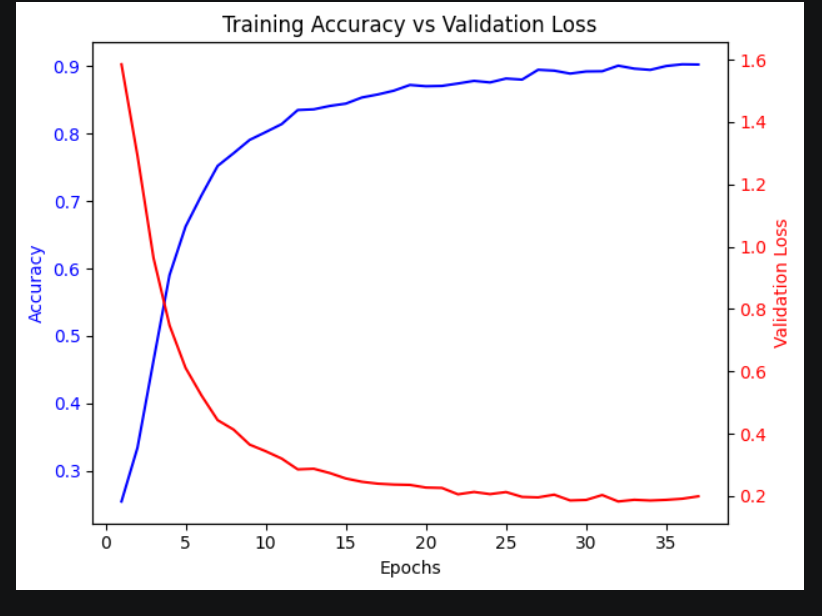
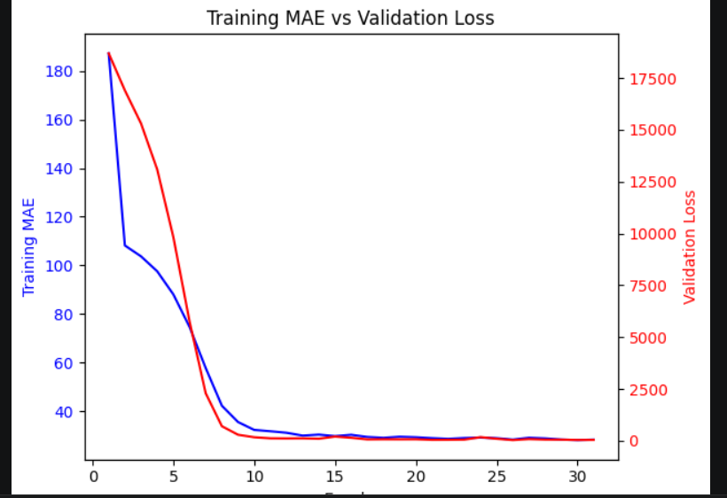
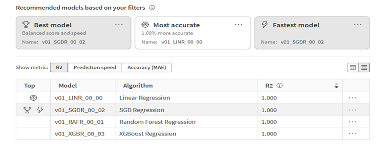

# ANN Classification and Regression on Coffee and Health Data

Two Artificial Neural Networks (ANNs) built on a synthetic dataset of **10,000 records** linking coffee consumption to health and lifestyle factors.

| Task | Goal | Best result |
|------|------|-------------|
| **Classification** | Predict a caffeine consumption category (ranges of `Caffeine_mg`) | **94.3% test accuracy**, F1 = 0.940 |
| **Regression** | Predict caffeine intake in mg (`Caffeine_mg`) | **MAE 4.19 mg**, R² = 0.9985 |

## Dataset

`synthetic_coffee_health_10000.csv` contains 10,000 synthetic records and 16 columns:

`ID, Age, Gender, Country, Coffee_Intake, Caffeine_mg, Sleep_Hours, Sleep_Quality, BMI, Heart_Rate, Stress_Level, Physical_Activity_Hours, Health_Issues, Occupation, Smoking, Alcohol_Consumption`

The data is synthetic, so results reflect patterns in the generated data and not real patients.

## Method

**Preprocessing**
- Missing value handling
- Train/test split performed before preprocessing, to avoid information leaking from the test set
- One-hot encoding for categorical features (Gender, Country, Sleep_Quality, Stress_Level, Health_Issues, Occupation)
- MinMax scaling for numerical features (Age, Coffee_Intake, Sleep_Hours, BMI, Heart_Rate, Physical_Activity_Hours)

**Classification target:** `Caffeine_mg` was grouped into 100 mg ranges during feature engineering to create the classes.

**Model:** feed-forward ANN built with Keras, using hidden layers with dropout regularisation, the Adam optimiser and early stopping.

**AutoML comparison:** the same data was also run as an experiment in Qlik AutoML (see `Qlik_Link_BI.txt`; the links need a Qlik Cloud login).

## Results

### Classification

| Metric | Value |
|--------|-------|
| Training accuracy | 0.9023 |
| Test accuracy | 0.9430 |
| Precision | 0.9391 |
| Recall | 0.9430 |
| F1 score | 0.9404 |

Test accuracy is slightly higher than training accuracy. This is expected with dropout, which switches neurons off during training but not during testing. The learning curves show training accuracy rising steadily (about 25% to 90%) and validation loss falling (about 1.6 to 0.2), with no sign of overfitting.

### Regression

| Metric | Value |
|--------|-------|
| Test loss (MSE) | 28.2165 |
| MAE | 4.1859 mg |
| RMSE | 5.3119 mg |
| R² | 0.9985 |

## Limitations

- **Possible data leakage:** `Coffee_Intake` is used as an input, and `Caffeine_mg` (the target) is very likely calculated from it. This probably explains the near-perfect R² and part of the classification accuracy. A fairer test would retrain the models without `Coffee_Intake`. [Add those results here if you run it.]
- **Synthetic data:** the results may not carry over to real-world data.

## Repository contents

| File | Description |
|------|-------------|
| `BI_CLASSIFICATION__MODEL.ipynb` | ANN classification notebook |
| `BI__Regression.ipynb` | ANN regression notebook |
| `synthetic_coffee_health_10000.csv` | Dataset |
| `BI_ Model Analysis Report.pdf` | Full analysis report |
| `Qlik_Link_BI.txt` | Links to the Qlik AutoML experiment |
| `images/` | Screenshots used in this README |

## Tools

Python | TensorFlow / Keras | scikit-learn | pandas | NumPy | Matplotlib | Qlik AutoML | Jupyter Notebook

## Author

**Mbionwu Daniel Chukwuebuka**
MSc Engineering and Data Science, University of Trás-os-Montes and Alto Douro (UTAD)
